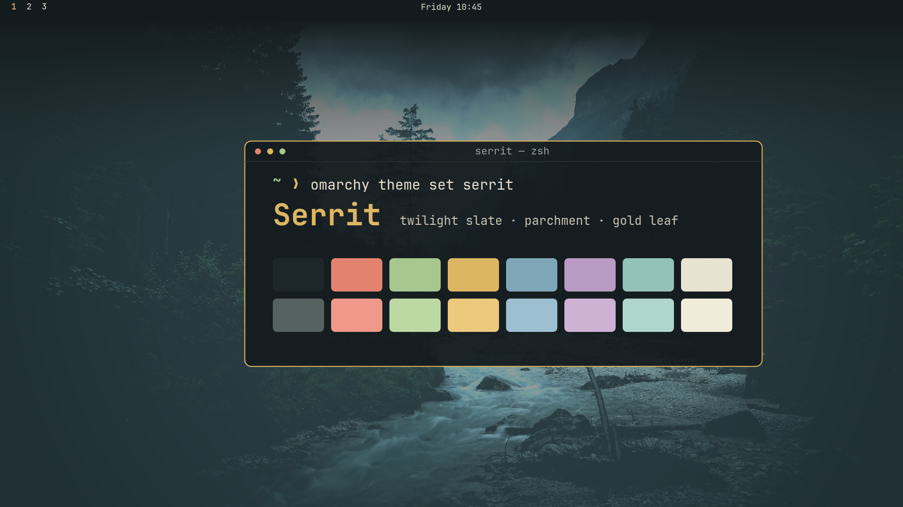

# Serrit

A dark Omarchy theme in twilight slate, parchment and gold leaf. Slate surfaces, warm cream text, a gold accent on borders and the cursor, and muted forest greens and river blues for everything else.



## Install

```sh
omarchy theme install https://github.com/emdmed/omarchy-serrit-theme
```

## What's in it

- `colors.toml`: the full palette. Omarchy generates the terminal, Hyprland, Neovim, btop, Chromium and shell colors from it.
- `icons.theme`: Yaru sage icons, which sit well next to the greens.
- A river-valley wallpaper (3840×2160), darkened toward the top so a transparent bar stays readable.

## Palette

| Role | Hex | Role | Hex |
|---|---|---|---|
| Background | `#141b1e` | Foreground | `#e8e2d0` |
| Accent | `#dcb662` | Selection | `#2f3d3a` |
| Red | `#e3836f` | Green | `#a6c78e` |
| Yellow | `#dcb662` | Blue | `#7fa7b8` |
| Magenta | `#b99ac2` | Cyan | `#93c3b8` |

## License

[MIT](LICENSE)
